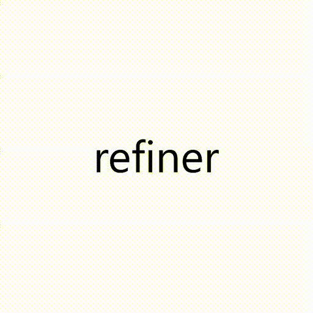

<p align="center"></p>
<h1 align="center">Refiner Discord Bot</h1>
<p align="center">"Feel free to praise me more" <(￣︶￣)></p>

## About Refiner

In order for [Discord Status as Image](https://disi.fyi/) to work, users' data need to be obtained by someone powerful, and Refiner is the one who can do that!

Why Refiner? I mean, why not? (￣ ▽ ￣)ノ She is the Greatest Mage of All Time after all 🪄

## Why the name Refiner?



## Local Development Setup

### Prerequisites

- A registered [Discord Bot Token](https://discord.com/developers/applications)
- [Python](https://www.python.org/) (>=3.12)
- [uv](https://docs.astral.sh/uv/)

### Environment Variables

1. Locate the `.env.example` file in the repository and duplicate it. Rename the duplicated file to `.env`.
2. Open the new `.env` file and populate it with your specific `APP_ID` and `TOKEN`.

### Start the Application

```bash
# Default uvicorn port: 8000
uv run uvicorn main:app --port 8010

# For hot reload
uv run uvicorn main:app --port 8010 --reload
```

The application is now running on `127.0.0.1:8010`.

## Technologies

- [discord.py](https://discordpy.readthedocs.io/en/stable/)
- [FastAPI](https://fastapi.tiangolo.com/)
- [SlowAPI](https://slowapi.readthedocs.io/en/latest/)
- [uvicorn](https://www.uvicorn.org/)
